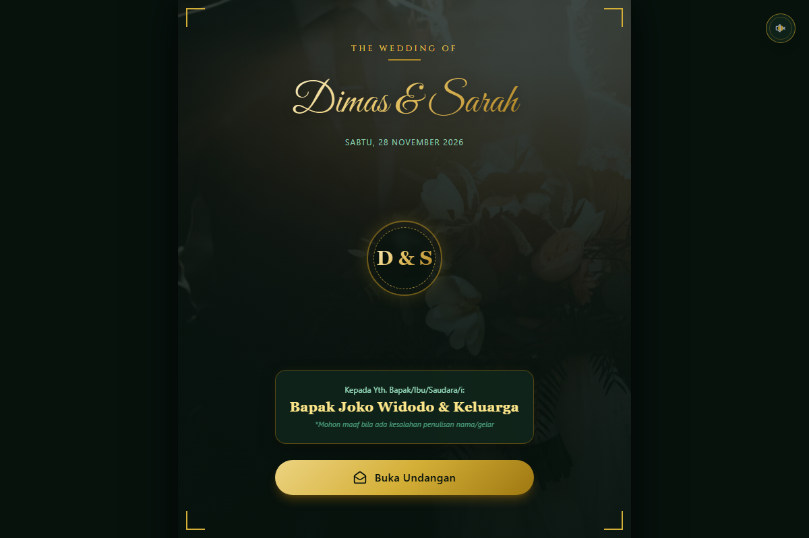
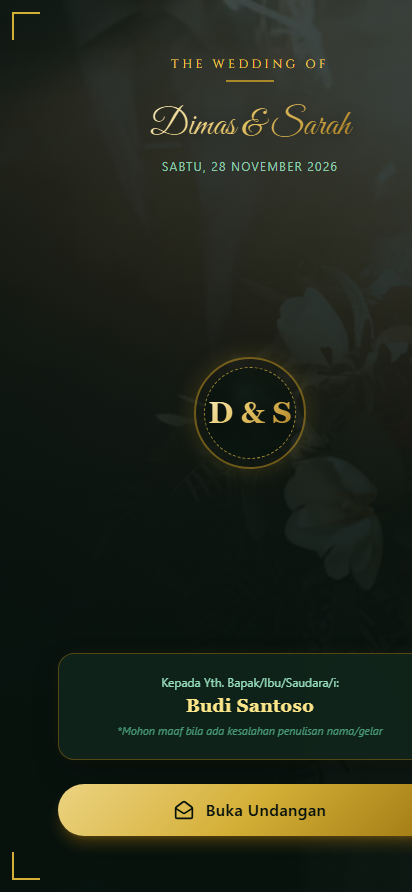
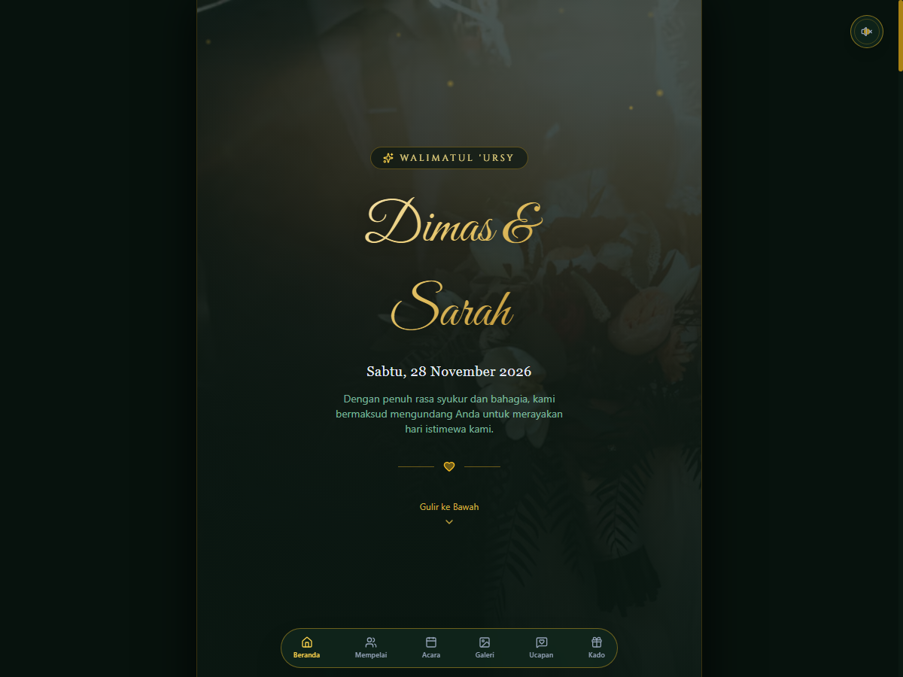
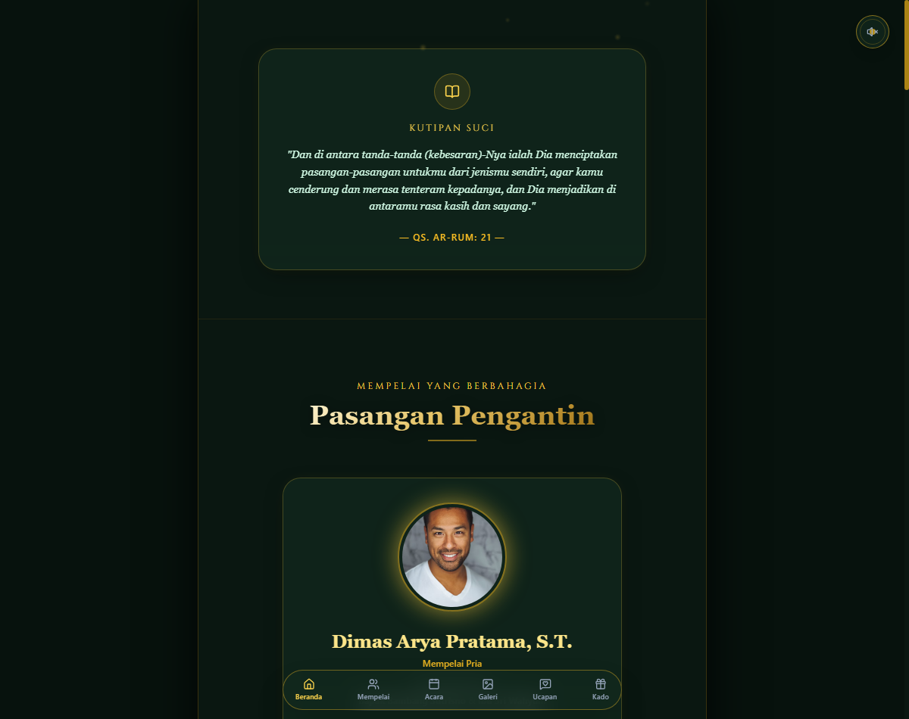

# 💍 Undangan Pernikahan Digital Responsif (Mobile & Laptop)

Undangan pernikahan digital berbasis web (*digital wedding invitation*) modern, elegan, dan interaktif dengan tema **Luxury Emerald & Champagne Gold**. Dirancang khusus agar tampil sempurna dan responsif di layar ponsel (smartphone) maupun layar laptop/desktop.

---

## 📸 Tangkapan Layar (Screenshots)

### 1. Tampilan Layar Pembuka (Cover Gate dengan Nama Tamu Dinamis)
| Tampilan Desktop / Tablet | Tampilan Smartphone (Mobile) |
| :---: | :---: |
|  |  |

### 2. Tampilan Isi Undangan (Hero & Profil Mempelai)
| Tampilan Pembuka Acara (Hero) | Profil Mempelai & Hitung Mundur |
| :---: | :---: |
|  |  |

---

## ✨ Fitur Utama

1. **Cover / Door Gate Eksklusif**:
   - Menampilkan salam personal dengan nama tamu yang diambil secara otomatis dari URL parameter (`?to=Nama+Tamu`).
   - Tombol interaktif *"Buka Undangan"* yang membuka cover secara halus dan memulai alunan musik latar.
2. **Background Music & Audio Controller**:
   - Pemutar audio latar bernuansa pernikahan yang lembut.
   - Dilengkapi *floating disc button* mengambang untuk memutar atau menghentikan (*mute/pause*) musik sewaktu-waktu.
   - Built-in Web Audio API synthesizer fallback (musik tetap berbunyi jika file eksternal terkendala).
3. **Profil Mempelai**:
   - Foto mempelai pria dan wanita berbingkai artistik dengan efek aura bercahaya (*glow*).
   - Informasi orang tua / keluarga besar dan tautan profil Instagram.
4. **Countdown Timer Real-time**:
   - Penghitung waktu mundur otomatis (Hari, Jam, Menit, Detik) menuju hari H pernikahan.
   - Tombol satu klik *"Simpan ke Google Calendar"*.
5. **Rangkaian Acara & Peta Navigasi**:
   - Rincian Akad Nikah dan Resepsi Pernikahan secara terpisah dan terstruktur.
   - Tombol petunjuk arah ke Google Maps dan sematan (*embed*) peta interaktif.
6. **Kisah Cinta (Love Story)**:
   - Garis waktu (*timeline*) perjalanan kasih dari awal bertemu, komitmen, hingga lamaran.
7. **Galeri Foto & Lightbox**:
   - Grid foto momen prewedding responsif.
   - Fitur *Lightbox Zoom*: klik foto untuk melihat dalam ukuran penuh dengan tombol navigasi *next/prev*.
8. **Buku Tamu & RSVP Digital**:
   - Form konfirmasi kehadiran (Hadir, Ragu, Tidak Hadir) dan jumlah tamu (*pax*).
   - Kolom pesan & doa restu yang langsung muncul di daftar ucapan secara realtime (tersimpan di *localStorage* browser).
9. **Amplop Digital (Wedding Gift)**:
   - Kartu rekening bank (BCA, Mandiri, dll.) dengan tombol *"Salin"* nomor rekening satu klik disertai animasi notifikasi *Toast*.
   - Alamat pengiriman kado fisik beserta fitur salin alamat lengkap.
10. **Navigasi Cepat (Mobile Floating Dock)**:
    - Menu navigasi mengambang di bawah layar ponsel untuk memudahkan tamu berpindah antar seksi dengan cepat.
11. **Efek Visual Partikel**:
    - Kelopak ornamen emas (*golden petals/sparkles*) yang berjatuhan lembut di latar belakang.

---

## 🚀 Cara Menjalankan Proyek

### 1. Menjalankan di Laptop / Komputer
Anda tidak perlu menginstal server khusus:
- Cukup **klik dua kali** berkas `index.html` untuk langsung membukanya di browser favorit Anda (Google Chrome, Edge, Safari, Firefox).
- Atau gunakan extension **Live Server** di VS Code.
- Atau jalankan server lokal sederhana melalui terminal:
  ```bash
  python -m http.server 8000
  ```
  Kemudian buka browser di `http://localhost:8000`.

### 2. Membuka di Handphone (HP)
- **Melalui Wi-Fi Lokal**: Jika laptop dan HP terhubung ke jaringan Wi-Fi yang sama, jalankan `python -m http.server 8000`, lalu di HP buka `http://<IP-Laptop-Anda>:8000`.
- **Melalui Hosting Gratis (Sangat Direkomendasikan)**: Unggah folder proyek ini ke **GitHub Pages**, **Vercel**, atau **Netlify** (cukup drag and drop folder proyek), lalu buka link yang dihasilkan di ponsel Anda.

---

## 🏷️ Cara Menggunakan Nama Tamu Dinamis

Cukup tambahkan parameter `?to=Nama+Tamu` di akhir alamat link website Anda:

- Contoh 1: `https://wedding-dimas-sarah.com/?to=Bapak+Joko+Widodo`
- Contoh 2: `https://wedding-dimas-sarah.com/?to=Budi+Santoso`
- Contoh 3: `https://wedding-dimas-sarah.com/?to=Keluarga+Besar+Alm+H.+Sulaiman`

Nama tamu otomatis tampil di Cover Pembuka dan otomatis terisi di kolom Nama pada form RSVP.

---

## ✏️ Panduan Kustomisasi Data

Semua data sangat mudah diubah pada berkas `index.html` dan `js/app.js`:

1. **Nama Mempelai & Tanggal**:
   - Buka `index.html`, cari teks `Dimas & Sarah` dan ganti dengan nama pasangan Anda.
   - Ganti teks tanggal `Sabtu, 28 November 2026`.
2. **Target Countdown Timer**:
   - Buka `js/app.js`, cari baris:
     ```javascript
     const targetDateStr = '2026-11-28T09:00:00+07:00';
     ```
   - Ubah sesuai tanggal dan jam akad nikah Anda (format: `YYYY-MM-DDTHH:mm:ss+07:00`).
3. **Nomor Rekening & Bank**:
   - Buka `index.html` pada bagian `<section id="kado">`.
   - Ubah nama bank, nama pemilik rekening, dan ganti atribut `data-copy="8820192834"` dengan nomor rekening Anda yang sebenarnya.
4. **Foto Galeri & Mempelai**:
   - Letakkan foto-foto Anda di dalam folder `assets/images/`.
   - Pada `index.html`, ganti atribut `src="..."` dan `data-gallery-src="..."` dengan path foto lokal Anda, misalnya `assets/images/foto1.jpg`.
5. **Musik Latar**:
   - Masukkan lagu MP3 pilihan Anda ke dalam folder `assets/audio/wedding-song.mp3`.
   - Pada `index.html`, ubah tag `<source src="..." type="audio/mpeg">` ke `assets/audio/wedding-song.mp3`.

---

## 📁 Struktur Berkas

```
undanganpernikahan5/
├── index.html        # Berkas utama seluruh struktur dan konten undangan
├── css/
│   └── style.css     # Pengaturan tema Luxury Emerald & Gold, animasi & responsivitas
├── js/
│   └── app.js        # Logika interaktif (cover, audio, countdown, RSVP, clipboard, modal)
├── assets/
│   ├── images/       # Folder untuk foto mempelai dan galeri
│   └── audio/        # Folder untuk file musik latar mp3
└── README.md         # Petunjuk penggunaan dan kustomisasi
```
